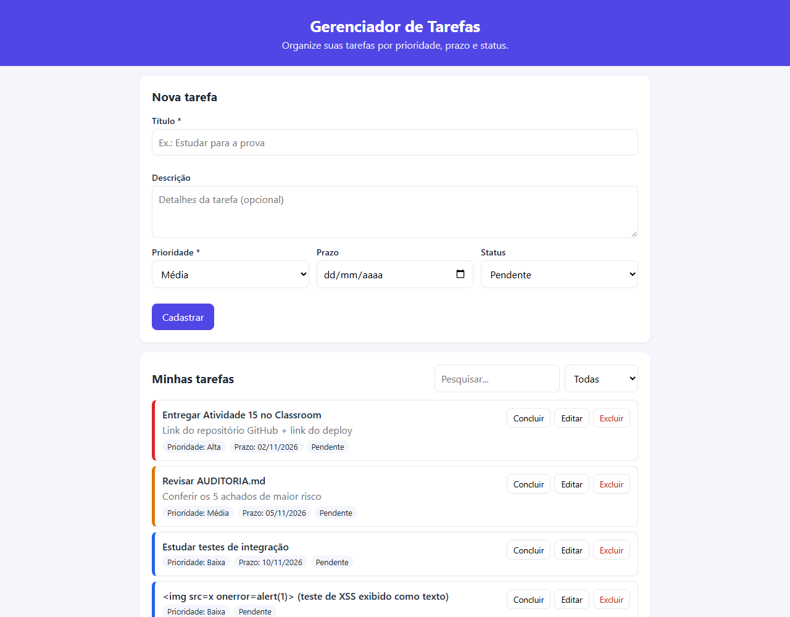
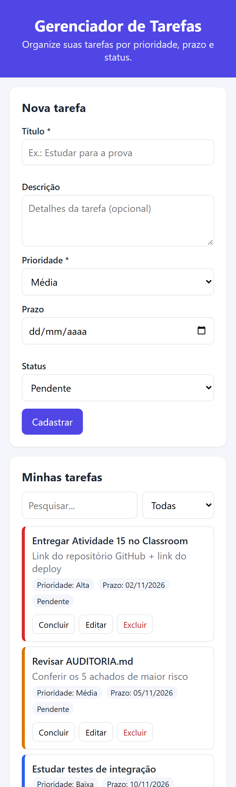

# Gerenciador de Tarefas — Atividade 15 (Git + Desenvolvimento de Software com IA)

> ## 🔗 Sistema publicado: **https://gerenciador-tarefas-ia.onrender.com**
> Repositório: https://github.com/victoraugustovalle/gerenciador-tarefas-ia
>
> O plano gratuito do Render "adormece" o serviço após 15 minutos sem acesso. Por isso, o primeiro acesso pode levar cerca de 1 minuto para carregar.

| | |
|---|---|
| **Aluno** | Victor Augusto |
| **Turma** | _preencher_ |
| **Ferramenta de IA** | Claude Code (Anthropic), usado no VS Code |

## Objetivo

Sistema web simples para **organizar tarefas pessoais**: o usuário cadastra o que precisa fazer, define prioridade e prazo, acompanha o que está pendente ou atrasado e marca o que já concluiu. Resolve o problema de tarefas espalhadas em papéis e anotações sem prioridade nem prazo.

## Funcionalidades

- **Cadastrar** tarefa com título, descrição, prioridade (baixa/média/alta), prazo e status.
- **Listar** tarefas: pendentes primeiro, ordenadas pelo prazo mais próximo, com cor por prioridade e selo de **atrasada**.
- **Consultar e pesquisar** por título ou descrição, com filtro por status.
- **Editar** qualquer campo da tarefa.
- **Alterar status** (Concluir / Reabrir).
- **Excluir**, com confirmação.
- **Validação no navegador e no servidor**: título obrigatório (3 a 100 caracteres), descrição até 500 caracteres, prioridade e status de uma lista fixa, prazo em data válida e não no passado (no cadastro).
- Mensagens de **sucesso e erro** compreensíveis, com o erro mostrado ao lado do campo.
- Layout **responsivo** para computador e celular.

## Tecnologias

| Camada | Tecnologia |
|---|---|
| Front-end | HTML, CSS e JavaScript puro (sem framework) |
| Back-end | Node.js 22.13+ (testado no 24) + Express 4 (API REST) |
| Banco de dados | SQLite pelo módulo nativo `node:sqlite` |
| Testes | `node:test` (nativo) + `supertest` |
| Hospedagem | Render (Web Service gratuito) |

### Por que SQLite?

É um banco relacional completo que fica em um único arquivo (`data/tasks.db`), não exige servidor de banco separado nem conta em serviço externo, e o Node já traz o driver (`node:sqlite`), sem dependência nativa para compilar. As regras também ficam garantidas no próprio banco por meio de restrições `CHECK`. Nos testes, o mesmo código usa um banco **em memória** (`:memory:`), totalmente separado do banco real.

**Limitação conhecida:** no plano gratuito do Render, o disco é **efêmero**, ou seja, os dados são apagados quando o serviço reinicia ou recebe um novo deploy. Para uma atividade acadêmica isso é aceitável. Em produção real, o caminho seria usar um disco persistente (pago) ou um banco gerenciado.

## Estrutura do projeto

```
├── server.js                  # inicia o servidor (porta) e exporta o app
├── src/
│   ├── app.js                 # Express: cabeçalhos de segurança, rotas, tratamento de erros
│   ├── config.js              # variáveis de ambiente (PORT, DB_PATH, APP_TIMEZONE)
│   ├── db.js                  # conexão SQLite e criação da tabela (com CHECKs)
│   └── tasks/
│       ├── taskRoutes.js      # camada HTTP (rotas /api/tasks)
│       ├── taskValidation.js  # regras de negócio e validação
│       └── taskRepository.js  # acesso a dados (todo o SQL fica aqui)
├── public/                    # interface (index.html, style.css, app.js)
├── tests/tasks.test.js        # 45 testes de integração
├── AUDITORIA.md               # relatório do Prompt 4
└── docs/
    ├── PROMPTS.md             # registro dos 4 prompts: achados, decisões e relato
    └── evidencias/            # capturas de tela e saída dos testes
```

## Como executar localmente

Pré-requisito: **Node.js 22.13 ou superior** (`node -v`).

```bash
git clone https://github.com/victoraugustovalle/gerenciador-tarefas-ia.git
cd gerenciador-tarefas-ia
npm install
npm start
```

Acesse **http://localhost:3000**. O banco `data/tasks.db` é criado automaticamente.

Variáveis de ambiente (opcionais, veja `.env.example`). Nenhuma delas é secreta:

| Variável | Padrão | Descrição |
|---|---|---|
| `PORT` | `3000` | Porta HTTP |
| `DB_PATH` | `data/tasks.db` | Caminho do arquivo SQLite |
| `APP_TIMEZONE` | `America/Sao_Paulo` | Fuso usado para saber qual é "hoje" na validação do prazo |

## API

| Método | Rota | Descrição | Respostas |
|---|---|---|---|
| GET | `/api/tasks?status=&q=` | Lista, filtra e pesquisa | 200, 400 |
| GET | `/api/tasks/:id` | Consulta uma tarefa | 200, 400, 404 |
| POST | `/api/tasks` | Cadastra | 201, 400 |
| PUT | `/api/tasks/:id` | Edita | 200, 400, 404 |
| PATCH | `/api/tasks/:id/status` | Define o status (`{"status":"concluida"}`) | 200, 400, 404 |
| DELETE | `/api/tasks/:id` | Exclui | 204, 400, 404 |

Exemplo de **entrada inválida** e o comportamento esperado:

```bash
curl -X POST http://localhost:3000/api/tasks -H "Content-Type: application/json" \
     -d '{"title":"ab","priority":"urgente","due_date":"2000-01-01"}'
```
```json
HTTP 400
{"error":"O título deve ter pelo menos 3 caracteres.",
 "fields":{"title":"O título deve ter pelo menos 3 caracteres.",
           "priority":"Prioridade inválida. Use baixa, media ou alta.",
           "due_date":"O prazo não pode estar no passado."}}
```

## Testes

Comando único, para rodar depois de **toda** alteração:

```bash
npm test
```

- **45 testes de integração** no estilo *request spec*: cada teste chama a rota HTTP real, com banco SQLite real **em memória**. O banco de produção nunca é usado, e há uma trava no início do arquivo de teste que aborta se o banco não for o de memória.
- Nada é mockado: banco, validação e regras rodam de verdade. O sistema não tem serviços externos, então não há o que simular.
- Cobrem o caminho feliz, os erros esperados, a repetição (clique duplo e requisições simultâneas com `Promise.all`), os limites (3 e 100 caracteres, prazo hoje, 10 kb) e a segurança (SQL Injection, XSS, cabeçalhos, erro interno sem stack).
- **Resultado atual: 45 passam, 0 falham.** Os mesmos testes rodados contra a versão inicial gerada pela IA: **22 falham** (veja `docs/evidencias/`).

Os cenários detalhados estão em [docs/PROMPTS.md](docs/PROMPTS.md#prompt-3--testes-de-integração).

### Testes manuais realizados

| Fluxo | Resultado |
|---|---|
| Cadastrar tarefa completa e só com o título | ✔ mensagem de sucesso, aparece na lista |
| Cadastrar com título vazio, com 2 letras e com prazo passado | ✔ erro ao lado do campo, nada é gravado |
| Editar tarefa → Salvar alterações / Cancelar edição | ✔ |
| Concluir / Reabrir | ✔ selo e risco no título mudam |
| Pesquisar e filtrar por status | ✔ |
| Excluir (com confirmação) | ✔ |
| Título com `` | ✔ aparece como texto e não executa |
| Uso no celular (390 px) | ✔ sem rolagem horizontal |

## Capturas de tela

| Computador | Celular |
|---|---|
|  |  |

## Deploy (Render)

O arquivo `render.yaml` já descreve o serviço. No Render: **New → Blueprint** (ou **Web Service**) → conectar este repositório. Build: `npm install`. Start: `npm start`. Plano: Free.

## Uso dos prompts de auditoria e qualidade

| Ordem | Prompt | Resultado principal |
|---|---|---|
| 1 | Prompt 4: auditoria completa | [AUDITORIA.md](AUDITORIA.md): 2 riscos altos (SQL Injection e XSS), validação só no front, stack exposto, status não idempotente |
| 2 | Prompt 1: segurança | Todos os achados de risco alto e médio corrigidos no commit `fix(segurança)` |
| 3 | Prompt 3: testes de integração | 45 testes; 22 deles teriam falhado na versão inicial |
| 4 | Prompt 2: refatoração segura | `server.js` dividido em 6 módulos em 4 passos, com os testes verdes em todos os passos |

O registro completo (achados, riscos, decisões, bugs anotados e relato) está em **[docs/PROMPTS.md](docs/PROMPTS.md)**. O histórico de commits mostra cada etapa separadamente.

## Limitações conhecidas

- Não há login: é um sistema de usuário único, e quem tiver o link pode editar as tarefas. A decisão está registrada na auditoria.
- No Render Free, os dados são apagados em reinícios e deploys (disco efêmero).
